# Farm O'Clock: accuracy report

**Run on 2026-11-15** with NASA POWER daily data (1985–Oct 2026) at 9 farming regions on 4 continents.
Every number here comes from scripts in `backend/eval/` and can be regenerated in about 1 minute (see [How to test it yourself](#how-to-test-it-yourself)).

## Headline results

| | Result |
|---|---|
| Recommended sowing week vs a random week | **39 % vs 28 %** low-risk seasons at 9 sites; **36 % vs 28 %** at **73 sites on 5 continents** |
| Flood-risk model vs the 20-year average | **+30 %** skill at known sites, **+13 %** on unseen regions; heat **+16 %** on unseen regions |
| Bug found and fixed | 3 of 9 regions were shown as **100 % high risk**; after the fix it is 21–22 % |
| Matches real harvests | Engine season stress vs FAOSTAT national yields: Spearman **−0.30** (133 site-years); Iowa 2012 caught |
| Confidence fixed | Calibrated "N in 10 seasons" is **9× more skilful** than the raw count (+0.071 vs +0.008) |
| Honest limits | Dry/Normal/Wet describes the past, not the future; the recommended week's own outcome isn't visible in national yields |

---

## 1. We found and fixed a bug in the risk engine

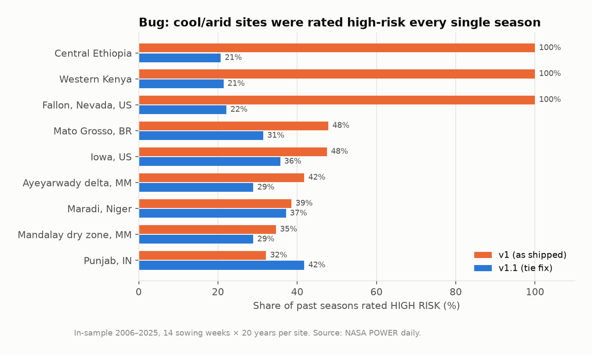

The heat check counts "days ≥ 35 °C" and ranks each season against past seasons. In cool places (Kenyan and Ethiopian
highlands) and irrigated deserts (Nevada), almost every season has **0** such days. The old ranking put those ties at the
very top, so every season looked like extreme heat. The fix ranks ties in the middle and treats 0 hot days as no heat
risk. It is applied in both the app (`web/src/app/api/replay/route.ts`) and the Python port.

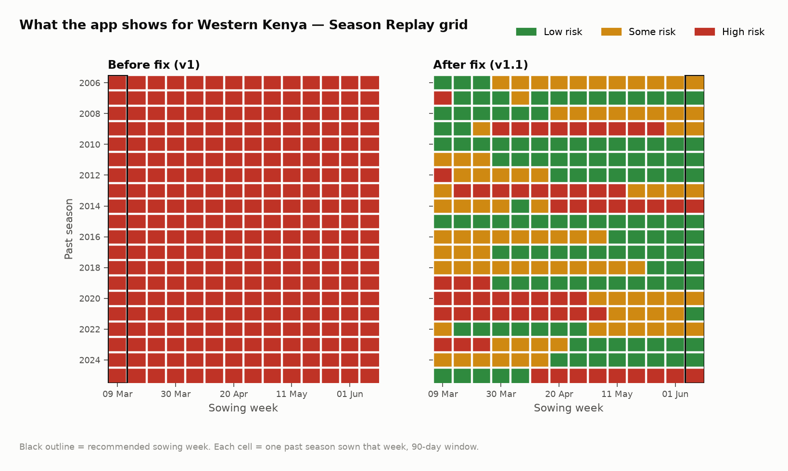

This is what a farmer in Western Kenya saw before (left) and sees now (right).

> **Trade-off:** in Punjab the share of high-risk seasons went *up*, from 32 % to 42 %. Punjab really is hot: many seasons
> have dozens of ≥ 35 °C days, so the fixed ranking now flags them correctly.

## 2. Does the recommended sowing week actually help?

**Test design (no cheating):** for each year from 2006 to 2025, the engine only sees the 20 years *before* that year, recommends a
week, and then we check how that week turned out in the year it had never seen. That gives 9 sites × 20 years = 180 tests.

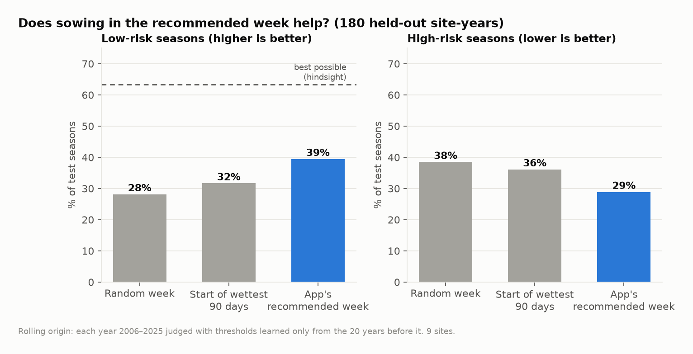

- The recommendation beats both a random week and the simple rule "sow at the start of the wettest 90 days".
- It reaches roughly a third of the possible gain: hindsight-best is 63 %, so the headroom is large.

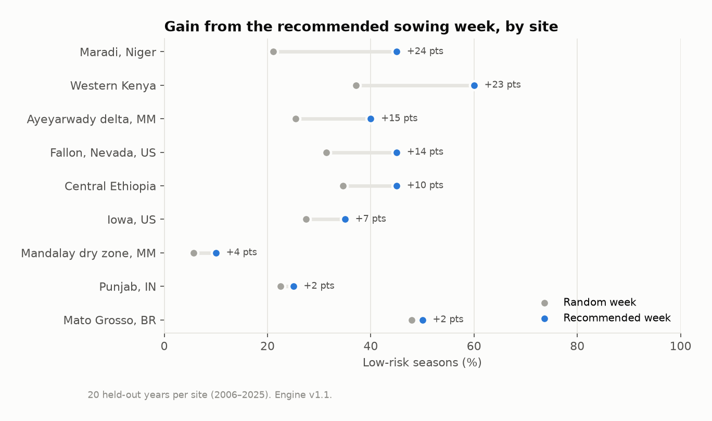

The gain is largest where rainfall timing matters most (Sahel, Kenya, Myanmar delta). It is near zero in Punjab and Mato Grosso, where
seasons are either reliably fine or reliably stressful whatever week you choose.

> **Stability issue found:** in the Ayeyarwady delta the recommended week jumped from **late May (2006–2014) to
> August (2015 onward)**, because the "wettest 90 days" anchor moved. Run `python -m eval.check_site 16.75 95.65` to see it.
> To do: anchor candidate weeks to crop calendars, or widen the 14-week search window.

## 3. Is the confidence number honest?

The app says, for example, "sown around 8 Jun, 13 of the last 20 seasons were low risk". We checked it against what happened the following year:

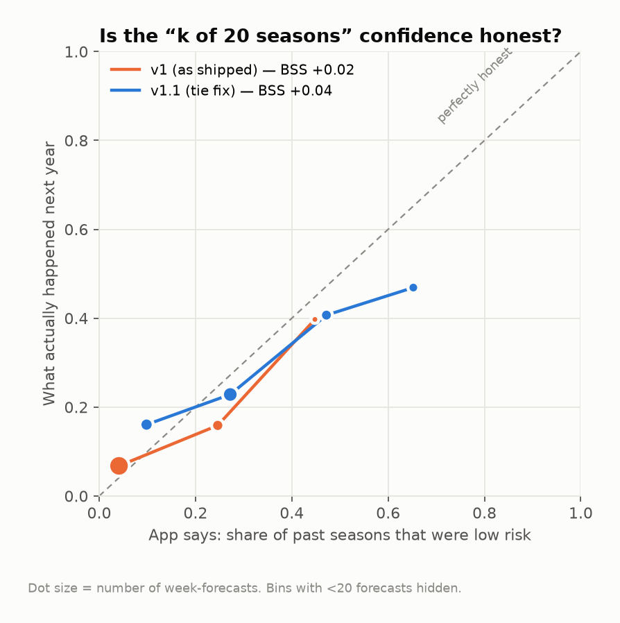

- Low and middle values are about right.
- **High values are optimistic:** when the app says about 65 %, the real rate next year was about 47 %.
- To do: shrink the number toward the site average (beta-binomial), or show words ("about half of years") instead of a fraction.

## 4. Is "This year so far: Dry / Normal / Wet" a forecast?

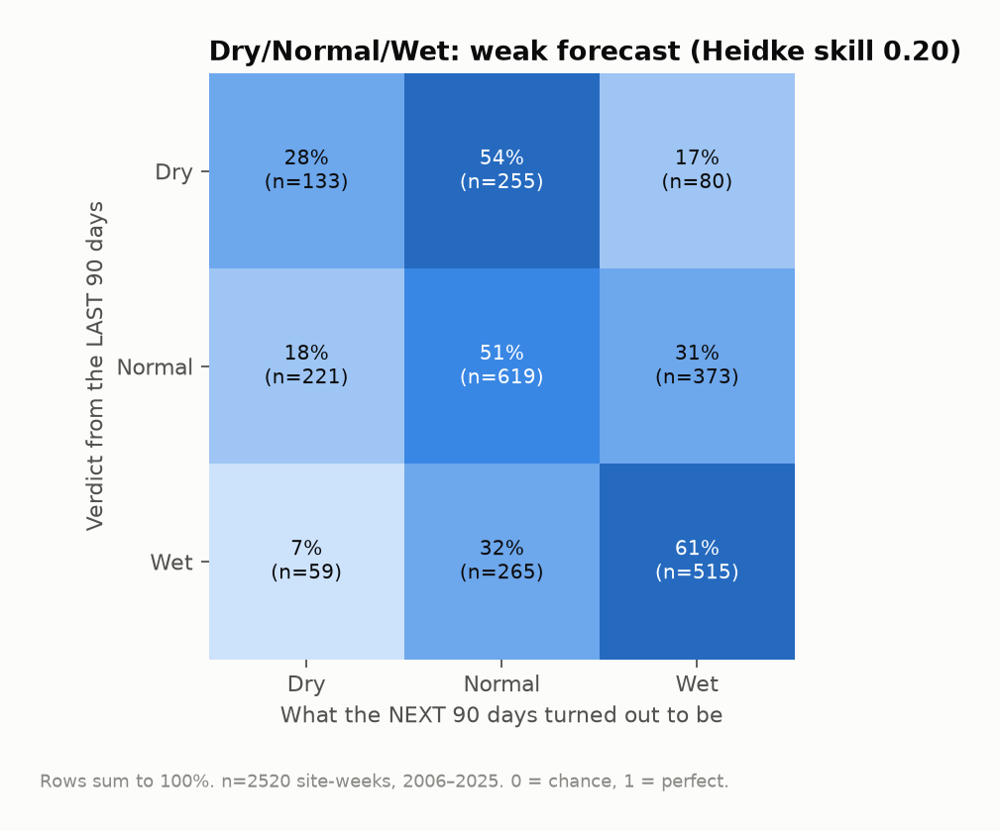

- **Wet tends to persist:** 61 % of "Wet" verdicts were followed by a wet next 90 days (monsoon and soil memory).
- **Dry does not:** only 28 % of "Dry" verdicts stayed dry. More often the next 90 days were normal.
- The overall Heidke skill is 0.20, so it is weak. The app now says this block describes recent weather and is not a forecast.
  A real outlook needs a seasonal forecast (Meteomatics / ECMWF), which is in `tasks.md`.

## 5. A first machine-learning risk model

The question it answers: at sowing time, given the last 30–90 days of rain, soil wetness and temperature, how likely is a bad season in the
next 90 days? Training uses 1987–2012 and testing uses 2013–2025, which the model never saw.

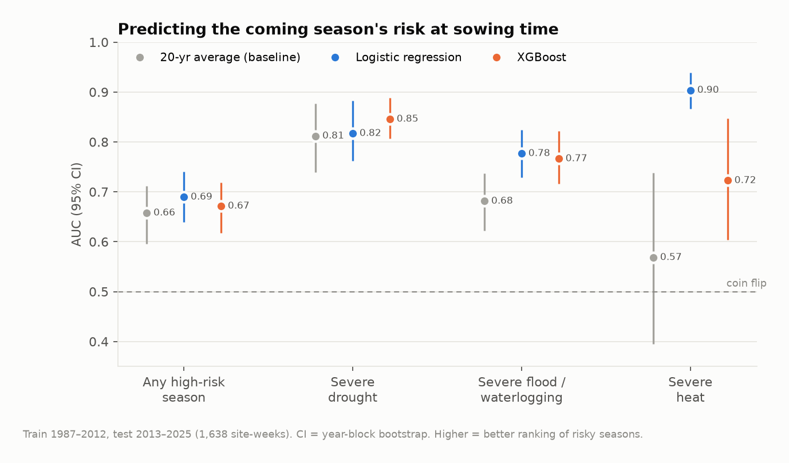

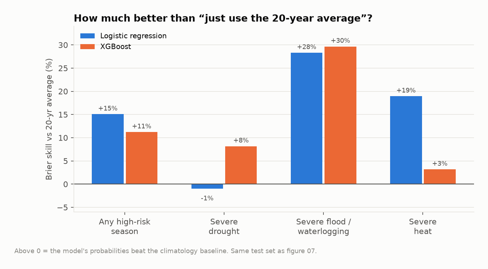

| Risk | Best model | AUC | Skill vs 20-yr average |
|---|---|---|---|
| Any high-risk season | Logistic | 0.69 | +15 % |
| Severe drought | XGBoost | 0.85 | +8 % |
| Severe flood / waterlogging | XGBoost ≈ Logistic | 0.77 | **+30 %** |
| Severe heat (only 4 % of seasons) | Logistic | 0.90 | +19 % |

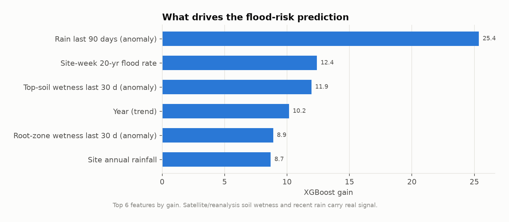

**What this means:** NASA soil-wetness and recent-rain data carry real predictive signal, especially for floods.
The simple **logistic regression is as good as XGBoost** with this much data. Ship the simple, explainable one first.
`Year` matters: risk is trending up, so fixed 20-year baselines understate today's risk.

## 6. Fixes shipped after the first report

**Confidence (section 3 fixed).** Recent seasons now count more (5-year half-life), and a correction curve learned from
2006–2015 maps the share onto what actually happened. Tested on 2016–2025:

| Method | Skill vs site average |
|---|---|
| Raw "k of 20" (before) | +0.008 |
| Shrinkage toward the site average | +0.020 |
| Recent years weighted | +0.050 |
| **Recent years weighted + correction curve (shipped)** | **+0.071** |

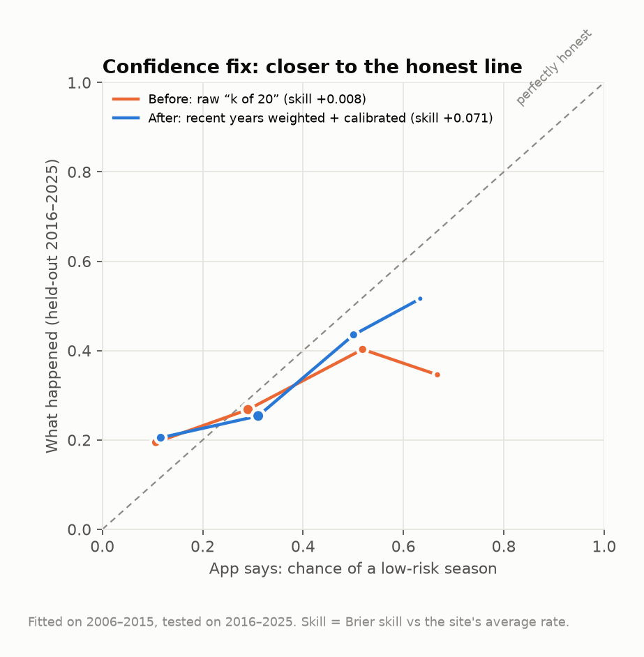

The app now says "about N in 10 seasons go well" using this calibrated number.

**Stable sowing week.** Candidate weeks are anchored to the full 1985+ climate record instead of a rolling 20 years.
Big year-to-year jumps of more than 4 weeks drop from 22 to 12, and the average shift falls from 10.7 to 7.6 days, at a cost of 1 point in low-risk rate.

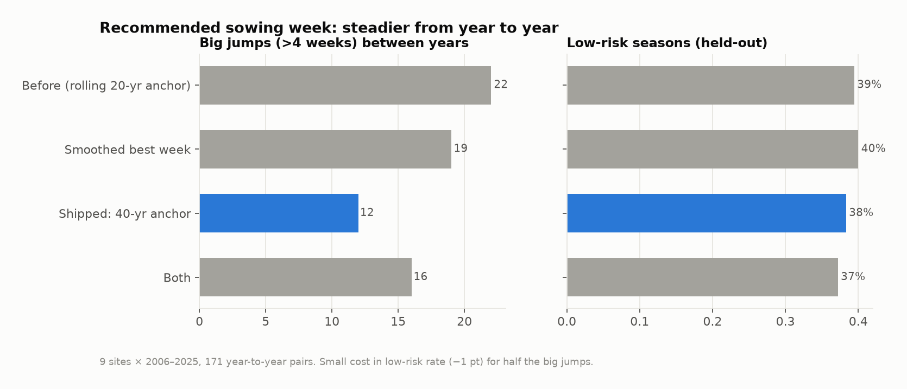

**Engine parity.** `backend/tests/test_parity.py` checks that the Python engine equals the live web engine cell by cell
(3 sites × 280 cells, including the calibrated chance). Rolling rain sums are rounded to 0.01 mm in both, so float noise can't break ties.

## 7. Does the engine match real harvests? (FAOSTAT)

National yields from FAOSTAT (Dec 2025 release) were detrended per country and crop, then compared with the engine's season stress at
7 sites, 2006–2024. Every year was rated using only the 20 years before it.

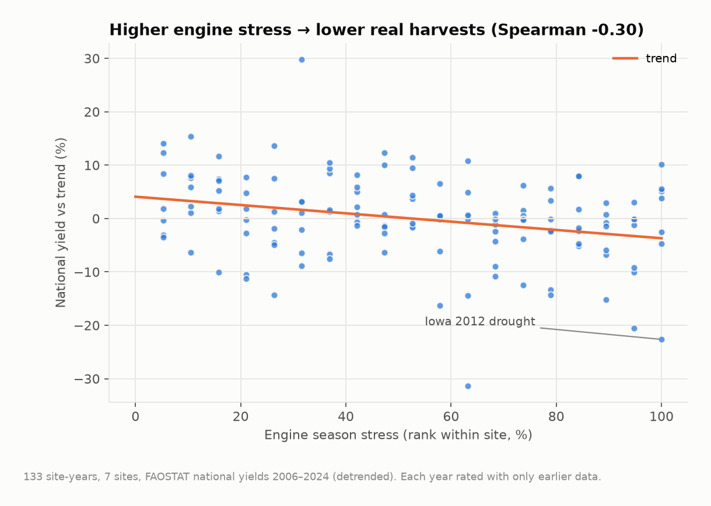

- **Higher stress goes with lower yields at all 7 sites** (Spearman −0.01 to −0.50; pooled **−0.30**, 133 site-years).
- Years in the top 20 % of stress averaged **−2.4 %** yield, compared with +0.6 % in other years.
- Iowa's highest-stress year is **2012**, the real drought, when yield was **−22.6 %**.
- **Honest negative:** whether the *recommended week* was rated low or high risk does **not** separate national yields.
  A country's yield mixes many sowing dates and regions, so this test needs field- or district-level yields.

## 8. New NASA data in the app

- **Soil (ISRIC SoilGrids, 250 m):** texture class, organic carbon and pH for the top 30 cm. This feeds the soil-health start of
  each rotation's soil trajectory.
- **Greenness (MODIS NDVI via Microsoft Planetary Computer):** current cover compared with the usual for the date (flags crop stress),
  and the months the field is usually bare. If the pin sits on water, the app asks the farmer to move it.

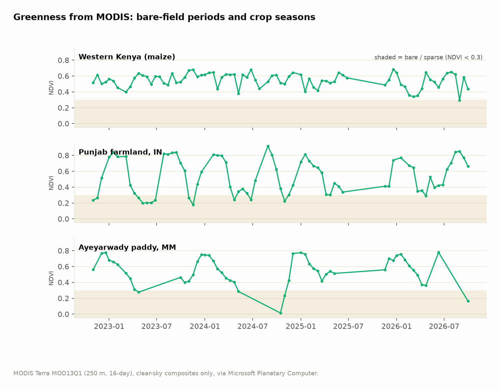

- **Water use (FAO-56):** Kc × Hargreaves ET₀ from NASA temperatures, minus effective rain, gives the extra water each rotation
  needs over 3 years. This replaces the hand-tuned "water" score. Example: Punjab rice → rice → rice needs about 1,930 mm of
  irrigation over 3 years, against about 1,540 mm with mung bean in year 2.
- **Seasonal forecast (Open-Meteo, 6 months, ensemble anomalies):** shifts the 20 past seasons by the forecast rain and heat
  anomaly for sowing weeks 30 days to 6 months away. Forecast skill this far ahead is limited and **not yet validated** here.
- **Farmer reports:** validated "damp/dry/flooded" reports within 10 km in the last 30 days are blended into the soil-moisture
  reading (3 reports ≈ equal weight with the satellite estimate).

**Tried and not shipped: AquaCrop-OSPy.** It runs fast (20 seasons in about 6 s on NASA weather), but uncalibrated it misses Iowa's
2012 drought: it predicts −4 % against roughly −25 % observed (May–Aug rain was 224 mm vs 455 mm normal). It needs calibration against yields first.

**Blocked: SMAP and GPM IMERG comparisons** need a NASA Earthdata login (see `tasks.md`).

## 9. Does it work anywhere? 73 sites and a spatial hold-out

64 more rural cropland points (Asia, Africa, the Americas, Europe, Australia) were added to the original 9.

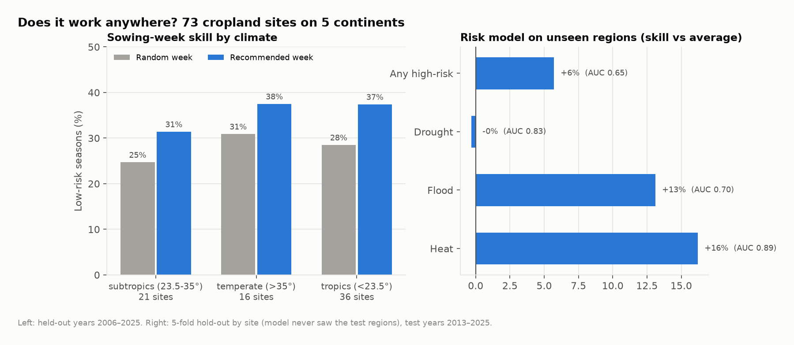

- **Sowing week (1,460 held-out site-years):** 35.7 % low-risk seasons with the recommended week vs 27.9 % for a random week
  (+28 % relative), and high-risk seasons fall from 38.4 % to 29.5 %. The gain holds in the tropics, subtropics and temperate
  zones, and the recommendation beats a random week at **73 % of sites**.
- **Risk model on regions it never saw** (5-fold, split by site, test years 2013–2025):

| Risk | Skill vs 20-yr average | AUC model / average |
|---|---|---|
| Any high-risk season | +6 % | 0.65 / 0.64 |
| Severe drought | **0 %** | 0.83 / 0.81 |
| Severe flood / waterlogging | **+13 %** | 0.70 / 0.67 |
| Severe heat | **+16 %** | 0.89 / 0.78 |

**What this means:** the gains are smaller than in the 9-site test (flood +30 % there), so section 5 was optimistic. The model still adds value
for flood and heat in new regions, but **not for drought**. For drought, the 20-year average is as good as the model, so the app's
outlook card should lean on the usual rate there. The flood and heat outlook generalises.

## 10. Rotation partner crops: data-driven vs a fixed table

The year-2 crop of the water-saving and soil-building plans used to come from a fixed table (rice → sorghum / mung bean
everywhere). Now each pin scores every candidate on three things: how often that crop's own season went well (last 20 years,
engine v1.1), its FAO-56 irrigation need, and whether the season's temperature suits it (FAO ECOCROP optimal range). It
then picks the best. **Held-out test:** picks made with 1996–2015 data, scored on 2016–2024, at 73 sites × rice and maize.

| Plan | Low-risk seasons (data / table) | Irrigation per season (data / table) | Data pick better |
|---|---|---|---|
| Water-saving | **29 %** / 25 % | **183 mm** / 235 mm | **95 %** of cases |
| Soil-building | **29 %** / 26 % | **193 mm** / 256 mm | **79 %** of cases |

The first version, without the temperature check, chose cool-season field pea even in hot monsoon climates. Adding crop
temperature ranges fixed that. Most common picks: chickpea, millet and cowpea for water-saving; chickpea, field pea (cool
sites only) and mung bean for soil-building. Still not modelled: local seed availability, markets and pests, which is why the
checklist asks the farmer to confirm seed is available. `backend/eval/partner_eval.py`, `data/partner_eval.json`.

---

## How to test it yourself

```bash
cd backend
python3 -m venv .venv && .venv/bin/pip install -r requirements-dev.txt   # once

.venv/bin/python -m pytest                     # 1. unit tests of the engine (6 tests)
.venv/bin/python -m eval.run_eval              # 2. all backtests  -> eval/results.json, eval/results.md
.venv/bin/python -m eval.make_figures          # 3. redraw every chart in reports/figures/
.venv/bin/python -m eval.check_site LAT LNG --name "My farm"   # 4. backtest ANY location, year by year
.venv/bin/python -m eval.improvements          # 5. confidence + stability experiments (sections 6)
.venv/bin/python -m eval.yield_check           # 6. FAOSTAT yield ground truth (section 7)
.venv/bin/python -m eval.scale_eval            # 7. 73 sites + spatial hold-out (section 9, ~15 min)
PARITY_WEB_URL=http://localhost:3000 .venv/bin/python -m pytest tests/test_parity.py   # 8. Python == web engine
.venv/bin/python -m eval.partner_eval          # 9. data-driven partner crops vs fixed table (section 10)
```

- The first run downloads about 40 years of NASA POWER data per site (a few seconds each) into `backend/.cache/`. After that it runs offline.
- To test more regions, add them to `SITES` in `backend/eval/run_eval.py` and re-run steps 2–3.
- To version the scores in Supabase: `python -m eval.upload_results v1.1 "note"` (needs `backend/.env`).
- In the app itself: run `cd web && npm run dev` and pin the same coordinates. Step 4 shows the same grid as figure 02.

## Files in this folder

| Path | Contents |
|---|---|
| `figures/*.png` | The 14 charts above |
| `data/results.json` | Every number from the backtests (raw) |
| `data/e0_engine_bug_by_site.csv` | Figure 01 data |
| `data/e1_sowing_window.csv`, `e1_per_site.csv`, `e1_calibration.csv` | Figures 03–05 data |
| `data/e3_risk_models.csv` | Figures 07–08 data (AUC, CI, Brier, skill) |
| `data/improvements.json` | Figures 10–11 (confidence fix, sowing-week stability) |
| `data/yield_check.json` | Figure 12 (FAOSTAT yield check) |
| `data/scale_eval.json` | Figure 13 (73 sites, spatial hold-out) |
| `data/partner_eval.json` | Section 10 (partner crops, held-out) |

## Caveats (say these to judges before they ask)

1. **Ground truth is mostly climate stress.** "Low risk" means no severe drought, flood or heat relative to local history. Section 7
   checks it against real (national) harvests: the direction is right, but national yields can't validate a single field's sowing week.
   District- or field-level yields are the next step.
2. **The core tests use 9 sites** (section 9 extends to 73). Overlapping sowing weeks are correlated, so the real sample is about 180 site-years. The confidence intervals use a year-block bootstrap for that reason.
3. **NASA POWER is about 50 km resolution.** It describes the area, not a single field. That is why the app ends with a field-check checklist and asks the farmer about their own soil.
4. **The rotation-strategy scores are still rule-based.** They are not evaluated here because there is no ground truth for them yet.
